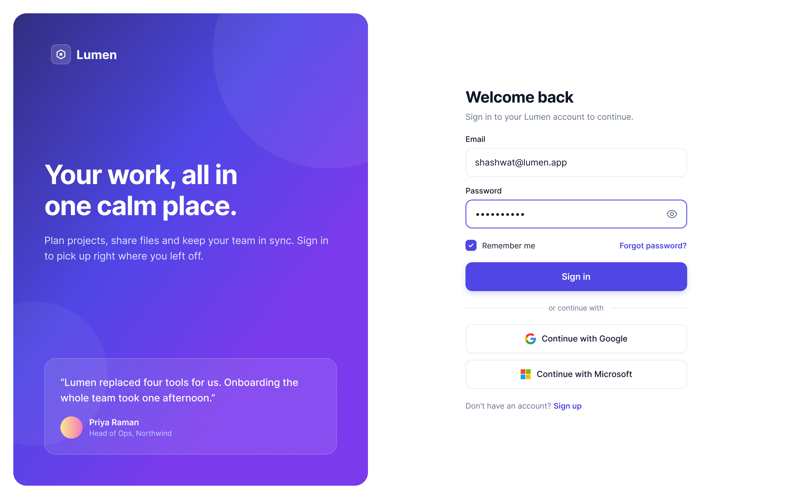
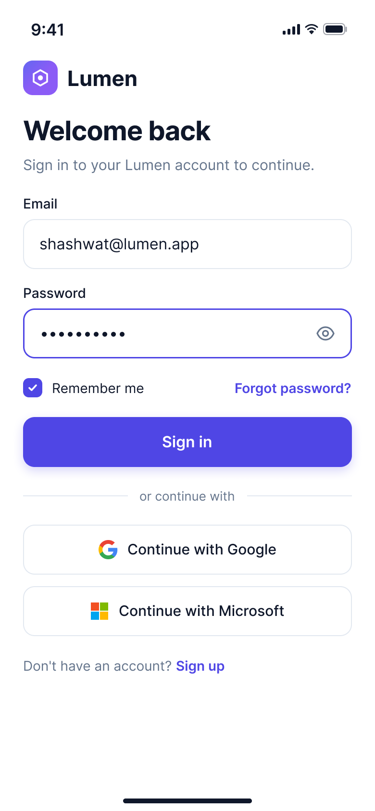

# Mini browser task

We want you to build a small browser tool for agents: an MCP that lets any agent read and act on
pages in a real Chrome. Write the part between the agent and Chrome yourself, over CDP.

The deliverable is an MCP my agent can work with. It should work on a tab in front, or in the
background while I use the same Chrome.

## Some things it should do

Each is given to the agent as one sentence and nothing else: no files, no links, no hints about
the page.

- Design. In Figma, design a sign-in flow for a mobile app and its desktop version, built from
  reusable components, with a working prototype. Export every screen.
- Video. In Canva, make a 15 second promo for a product of your choice from clips and music you
  find on the web, with a title and a closing card. Export it and check the result by playing
  it.
- Drawing. In Kleki, paint a portrait of Albert Einstein. Save it as a PNG.

Results like these, at about this cost in model spend:

- Design: [every screen](examples/lumen-sign-in), $1.10.
- Video: [a 15 second promo](examples/ember-roast.mp4), $1.20.
- Drawing: [the portrait](examples/einstein-portrait.png), $0.80.

It should also be able to work in scenarios like these:

- Nested frames inside websites.
- Components that hide their insides from the page.
- A tab that is in the background.
- Long lists and very large pages.
- Canvas apps.
- Rich text editors, date pickers, dropdowns, code boxes and sliders.
- File uploads.
- Alerts, downloads, permission prompts and sign-in popups.
- Pages that keep changing.

Think about all the website use cases an agent could face, and handle as many as you can.

## Before you build

Write a short design document first: what the agent sees and why, how you name elements, how
you know a page has finished reacting, how the agent learns what an action did, and what you
left out. Commit it before you build, then add what changed and why, keeping the original.

Write this part yourself, not with an agent. We want your thinking. You can use coding agents
for the implementation, but be ready to explain the code. No unit tests needed.

## Send us

- The code, and how to run it and add it to an agent.
- Your manually written research, design, plan and notes on what changed.
- Anything else that shows what it can do: recordings, results, cases it handles that we did
  not ask for.
